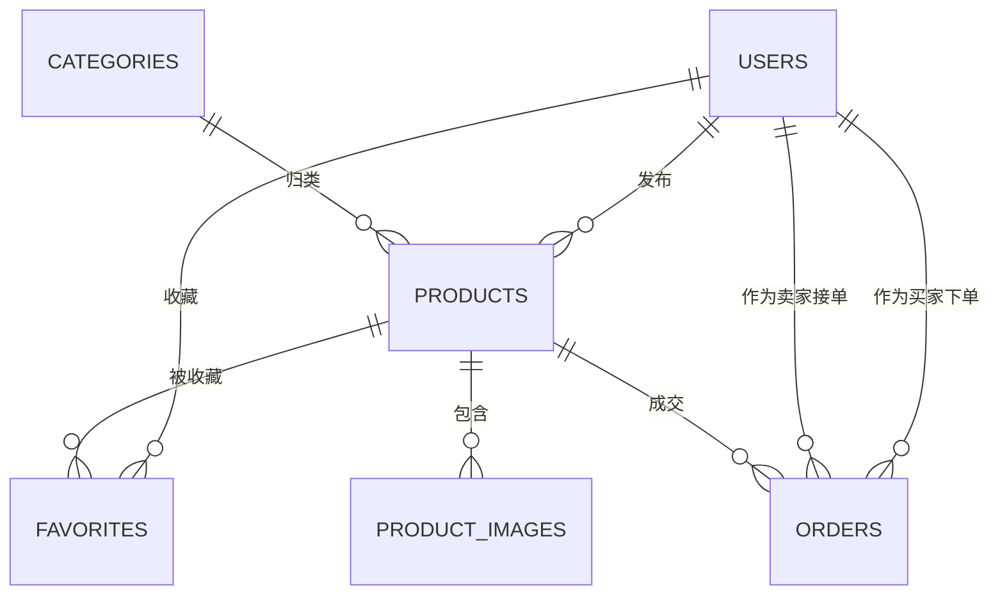

# 校园二手交易平台 需求分析

## 1. 项目概述

### 1.1 背景

校园内学生闲置物品（教材、电子产品、生活用品等）流转频繁，但缺乏集中、可信的交易信息渠道。现有做法依赖社群发言，信息零散、检索困难、成交后无法追溯。

### 1.2 项目目标

构建一个面向校园的二手交易 Web 平台，实现商品发布、检索、交易撮合与平台数据统计，使闲置物品能够高效流转，并通过统计接口与可视化图表体现数据的加工与分析过程。

### 1.3 项目范围

- 形态：响应式 Web 应用，适配手机浏览器，不含原生 App
- 数据库：MySQL
- 用户范围：同一校园内的在校学生
- 交易范围：以线下面交为主，平台不承担资金流转
- 使用前提：所有功能均需登录后使用，不设游客浏览
- 交付重点：完整的数据模型、可演示的业务闭环、平台数据统计与可视化

## 2. 用户角色

| 角色 | 说明 | 主要权限 |
| --- | --- | --- |
| 注册用户 | 已登录学生，兼具买家与卖家身份 | 发布/编辑/下架商品、收藏、下单预订、查看订单、管理个人信息、查看平台统计 |
| 管理员 | 由注册用户中指定 | 下架违规商品、封禁违规用户 |

说明：

- 买家与卖家不做身份区分，任何注册用户既可发布商品也可购买商品
- 不设游客角色，未登录访问一律跳转登录页，权限模型因此简化为「登录用户」与「管理员」两级
- 管理员不单独建表，在用户表中以标记字段区分

## 3. 功能性需求

### 3.1 用户模块

| 编号 | 需求 | 说明 |
| --- | --- | --- |
| U1 | 注册 | 以学号或邮箱注册，校验唯一性 |
| U2 | 登录 | 账号密码登录，成功后签发 JWT |
| U3 | 个人信息管理 | 修改昵称、头像、联系方式 |
| U4 | 我的记录 | 查看本人发布的商品、作为买家或卖家参与的订单 |

### 3.2 商品模块

| 编号 | 需求 | 说明 |
| --- | --- | --- |
| P1 | 发布商品 | 填写标题、描述、价格、分类、成色、交易地点，上传图片 |
| P2 | 编辑与下架 | 发布者可修改信息或下架商品 |
| P3 | 商品状态管理 | 在售 / 已预订 / 已售出 / 已下架 |
| P4 | 商品列表 | 分页展示，按发布时间倒序 |
| P5 | 分类筛选 | 按分类浏览商品 |
| P6 | 关键词搜索 | 依据标题与描述进行模糊检索 |
| P7 | 商品详情 | 图片浏览、卖家信息、发布时间、浏览量 |
| P8 | 收藏 | 收藏 / 取消收藏商品，查看收藏列表 |

### 3.3 订单模块

平台不进行在线支付，交易在确认意向后线下面交完成，系统负责记录订单状态。

| 编号 | 需求 | 说明 |
| --- | --- | --- |
| T1 | 下单预订 | 买家对在售商品发起预订，商品转为已预订 |
| T2 | 订单状态流转 | 待确认 → 已确认 → 已完成 / 已取消 |
| T3 | 取消订单 | 买家或卖家可取消未完成的订单，商品恢复在售 |
| T4 | 完成确认 | 双方确认面交完成后，订单置为已完成，商品置为已售出 |
| T5 | 我的订单 | 分别查看作为买家与作为卖家的订单列表 |

### 3.4 数据统计与可视化

该部分为项目的重点交付内容，用于体现数据加工与聚合查询的实现。

| 编号 | 需求 | 呈现形式 |
| --- | --- | --- |
| D1 | 平台概览 | 用户数、商品总数、在售数、累计成交量等指标卡 |
| D2 | 分类分布 | 各分类在售商品数量，饼图或柱状图 |
| D3 | 价格区间分布 | 按价格分段统计商品数量，柱状图 |
| D4 | 发布与成交趋势 | 近 N 天新增商品数、成交订单数，折线图 |
| D5 | 热门商品 | 按浏览量或收藏量排序的 Top N 商品 |

统计页面对所有登录用户开放，无需单独的管理后台。

### 3.5 管理功能

| 编号 | 需求 | 说明 |
| --- | --- | --- |
| A1 | 商品下架 | 管理员下架违规商品 |
| A2 | 用户封禁 | 管理员封禁或解封账号 |

## 4. 非功能性需求

| 类别 | 要求 |
| --- | --- |
| 安全 | 密码以哈希方式存储；接口通过 JWT 鉴权；区分普通用户与管理员权限；数据库操作使用参数化查询防止注入 |
| 性能 | 商品列表分页返回；对常用检索字段建立索引；图片做尺寸限制 |
| 一致性 | 下单、取消订单、完成订单涉及商品与订单两张表，须在同一事务内完成 |
| 可用性 | 页面适配移动端；关键操作给出明确的成功与失败提示 |
| 可维护性 | 前后端分离，接口与数据结构集中约定，便于分工与后续扩展 |

## 5. 数据需求

### 5.1 核心实体

| 实体 | 关键字段 | 说明 |
| --- | --- | --- |
| 用户 users | id, student_no, email, password_hash, nickname, avatar, contact, is_admin, status, created_at | 平台注册用户，`is_admin` 标记管理员，`status` 标记是否封禁 |
| 分类 categories | id, name, sort_order | 商品分类，数据预置 |
| 商品 products | id, seller_id, category_id, title, description, price, condition_level, status, trade_place, view_count, created_at | 二手商品主信息 |
| 商品图片 product_images | id, product_id, url, sort_order | 一件商品对应多张图片 |
| 收藏 favorites | id, user_id, product_id, created_at | 用户与商品的多对多关系 |
| 订单 orders | id, product_id, buyer_id, seller_id, status, trade_place, contact, created_at, finished_at | 交易记录 |

### 5.2 实体关系



### 5.3 数据约束要求

- 用户学号与邮箱唯一
- 商品价格为正数，状态取值受限于枚举范围
- 订单的买家与卖家不能为同一人
- 商品存在未完成订单时不可重复下单
- 同一用户对同一商品仅保留一条收藏记录
- 图片、收藏记录随所属商品删除而级联清理
- 表名统一使用复数形式，避开 MySQL 保留字（如 `order`、`condition`），必要时以反引号包裹

## 6. 核心业务流程

```
发布商品 → 被浏览/搜索 → 买家下单预订 → 卖家确认
    → 线下面交 → 双方确认完成 → 商品置为已售出
```

异常分支：

- 买家取消或卖家拒绝 → 订单置为已取消，商品恢复在售
- 商品被管理员下架 → 不再出现在列表中，进行中的订单需双方线下沟通

## 7. 需求范围边界

明确不在本期范围内，避免工作量失控：

- 在线支付与资金担保
- 物流配送与快递对接
- 原生移动端 App
- 商品留言与订单评价、信用分机制
- 私信聊天
- 举报处理与分类管理
- 推荐算法

## 8. 优先级划分

| 优先级 | 内容 |
| --- | --- |
| P0（必须完成） | 注册登录、商品发布与列表检索、商品详情、下单与订单状态流转、概览与分类分布统计 |
| P1（应当完成） | 收藏、多图上传、趋势与热门商品统计、管理员下架与封禁、可视化图表 |
| P2（加分项） | 价格区间组合筛选、活跃卖家排行、成交率分析 |

## 9. 待组内确认事项

以下问题影响数据模型与接口设计，需在开发前确定：

1. 登录凭证使用学号、邮箱还是两者皆可
2. 订单是否需要「卖家确认」环节，还是下单即成交
3. 图片存储方式：本地磁盘目录还是对象存储
4. 管理员账号的创建方式：数据库预置还是由已有管理员授予
5. 商品分类是固定预置，还是保留扩展的可能

## 10. 模块分工映射

| 角色 | 对应需求模块 | 主要交付物 |
| --- | --- | --- |
| 前端 | 商品列表与详情、发布表单、订单页面、统计图表 | 页面与组件、接口调用、图表渲染 |
| 后端 | 用户、商品、订单接口与业务逻辑 | 接口实现、鉴权、事务处理 |
| 数据库 | 表结构、关系与约束、统计查询 | 建表脚本、索引、聚合查询语句 |

三者存在依赖：数据库表结构确定后后端方可实现接口，接口格式确定后前端方可对接。因此第 5 节的实体设计与接口约定需先行完成。
